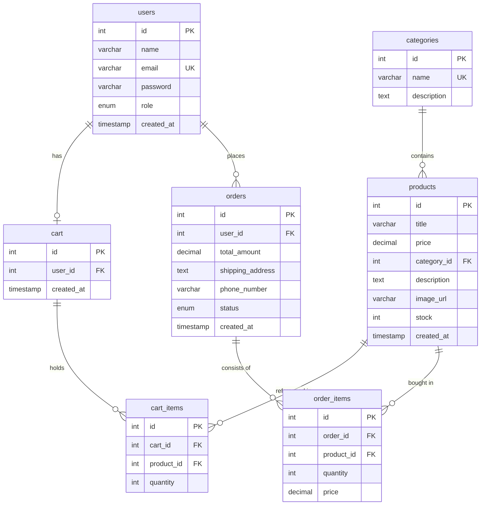

# ShopSphere 🌌 — Premium E-Commerce DBMS College Project

ShopSphere is a fully working, secure, and modern E-Commerce web application designed as a comprehensive database management systems (DBMS) college project. It demonstrates how to connect a responsive frontend (Vanilla HTML/CSS/JS) to a robust backend server (Node.js + Express) and a relational database (MySQL) using industry-standard engineering paradigms.

---

## 🌟 Core Features Included

1. **Authentication System**: Dynamic User Registration, secure Sign-In, and Sign-Out utilizing JSON Web Tokens (JWT) and one-way password hashing via `bcryptjs`.
2. **User Role Division**: Segmented interfaces and API privileges for **Normal Customer Accounts** and **Administrative Dashboard Accounts**.
3. **Responsive Product Catalog**: Real-time keyword search, sidebar category filtering, and Price Ascending/Descending sort ordering powered by active parameterized SQL queries.
4. **Interactive Shopping Cart**: Adding items, live quantity increments, subtotal calculations, and item removals synced with the backend `cart_items` table.
5. **ACID Transactional Checkout**: Uses explicit **MySQL Transactions** to place orders, allocate items, verify stock levels, subtract inventory, and flush carts. Safe rollbacks occur on inventory conflicts or errors.
6. **Detailed Order Tracking**: Historical logs dashboard with active status badges (Pending, Shipped, Delivered) and a **Line-Items Receipt Modal Popup** querying details by order ID.
7. **Administrative Dashboard**: Net Revenue statistics, product catalog CRUD (Add, Edit, Delete modals), registered users directory view, and live shipment status updates.

---

## 🛠️ Technology Stack

* **Frontend**: HTML5, CSS3 (Custom Variables, glassmorphism, responsive grids), Vanilla JavaScript (ES6, Fetch REST APIs, DOM controllers). No Tailwind, Bootstrap, or frameworks.
* **Backend**: Node.js, Express.js (MVC routing, middleware guards, JSON controllers).
* **Database**: MySQL (pooled Promise driver, normalized tables, cascade foreign keys).
* **Security & Auth**: Bcrypt Hashing, JWT Session tokens, Parameterized queries.

---

## 📂 Project Structure

```text
DBMS/
│
├── database/
│   └── shopsphere.sql          # Full MySQL Schema dump & preloaded seed inserts
│
├── backend/
│   ├── config/
│   │   └── db.js               # Self-healing pooled MySQL connection & tables builder
│   ├── controllers/
│   │   ├── authController.js   # User profiles, login verification, hashing
│   │   ├── productController.js# Catalog lists, categories, CRUD actions
│   │   ├── cartController.js   # Shopping cart modifications
│   │   └── orderController.js  # ACID Transaction checkouts & histories
│   ├── middleware/
│   │   └── authMiddleware.js   # JWT protection & admin privilege guards
│   ├── routes/
│   │   ├── authRoutes.js       # Express routes mapping for auth
│   │   ├── productRoutes.js    # Express routes mapping for products
│   │   ├── cartRoutes.js       # Express routes mapping for cart
│   │   └── orderRoutes.js      # Express routes mapping for orders
│   ├── server.js               # Main starting server hosting static files
│   ├── .env                    # Environment credentials variables
│   └── package.json            # Script commands and dependencies list
│
└── frontend/
    ├── css/
    │   └── style.css           # Global high-fidelity responsive stylesheet
    ├── js/
    │   ├── main.js             # JWT helper, dynamic navigation, notifications
    │   ├── auth.js             # Sign-In/Sign-Up form submissions
    │   ├── products.js         # Catalog rendering, filters, detail viewers
    │   ├── cart.js             # Table rows, subtotals, quantity triggers
    │   ├── checkout.js         # Billing address submits, success recap screen
    │   ├── orders.js           # Purchases lists, tracking cards, detailed modal
    │   └── admin.js            # Dashboard stats, product CRUD modal, status updates
    ├── index.html              # Homepage & featured releases
    ├── products.html           # Two-column shopping catalog
    ├── product-details.html    # Detail overview & stock indicators
    ├── cart.html               # Tabular cart lists
    ├── checkout.html           # Billing shipping details form
    ├── orders.html             # Historical order sheets
    ├── login.html              # Secure portal access
    ├── register.html           # New account signup
    └── admin.html              # Admin panel workbench
```

---

## 💾 Relational Database Schema Design

The database utilizes **7 normalized tables** mapped with appropriate primary and foreign key constraints:



---

## 🚀 Quick Setup & Installation Guide

Follow these steps to run ShopSphere locally on your computer:

### 1. Prerequisite Checklist
* Install [Node.js](https://nodejs.org/) (Includes `npm` package manager).
* Install a local MySQL server (Typically using [XAMPP](https://www.apachefriends.org/), WampServer, or direct MySQL Community Server installations).

### 2. Configure MySQL Database
1. Launch **XAMPP Control Panel** and start the **Apache** and **MySQL** services.
2. Open your web browser and navigate to **phpMyAdmin**: `http://localhost/phpmyadmin/`
3. Click the **SQL** tab and execute:
   ```sql
   CREATE DATABASE shopsphere;
   ```
4. You do not need to manually import any database tables! ShopSphere is engineered with **Self-Healing DB Initializers**. When the server starts up, it automatically builds the schemas and loads 8 sample products for you.
*(Alternatively, you can manually import the file [database/shopsphere.sql](file:///c:/Users/gsksa/Desktop/DBMS/database/shopsphere.sql) inside phpMyAdmin if you prefer).*

### 3. Install & Start Server
1. Open your terminal or Command Prompt in the project's **`backend` directory**:
   ```bash
   cd c:\Users\gsksa\Desktop\DBMS\backend
   ```
2. Install the necessary project dependencies:
   ```bash
   npm install
   ```
3. Start the node server in development auto-reload mode:
   ```bash
   npm run dev
   ```
4. On success, you should see the following console confirmation:
   ```text
   [Database] Connected to MySQL pool on database: shopsphere
   [Database] Relational tables checked and verified successfully.
   =============================================================
      ShopSphere Stack Server is running!
      Local Server Access URL: http://localhost:5000
   =============================================================
   ```

### 4. Visit the Application
Open your browser and load the URL:
👉 **`http://localhost:5000`**

---

## 🔑 Preloaded Evaluator Accounts

To showcase features to graders quickly without creating accounts, use these preloaded accounts:

### 👤 Normal Customer Account
* **Email**: `user@shopsphere.com`
* **Password**: `user123`
* *Features to demo*: Add Sony headphones to cart, increase quantities to 2, proceed to checkout, enter shipping address, place the order, track order status in "My Orders", and inspect the Receipt Modal.

### 👑 Admin Dashboard Account
* **Email**: `admin@shopsphere.com`
* **Password**: `admin123`
* *Features to demo*: Click the "Admin Panel" tab. View revenue tallies, open the "+ Add New Product" modal, create a product, edit price details, view the Customer Directory, and change the shipment status of orders (e.g. Pending -> Shipped) inside the dropdown.

---

## 🎓 Key DBMS Viva Presentation Topics

Prepare these answers for questions from evaluators:

### 1. How is SQL Injection Prevented?
In [backend/config/db.js](file:///c:/Users/gsksa/Desktop/DBMS/backend/config/db.js), we avoid concatenating raw text inputs into SQL strings (e.g., `WHERE email = '` + email + `'`). Instead, we enforce **parameterized queries** using a promise wrapper:
```javascript
db.query('SELECT * FROM users WHERE email = ?', [email]);
```
The MySQL driver automatically sanitizes the email variable as data, neutralizing any malicious SQL commands injected inside form fields.

### 2. How do SQL Transactions Ensure ACID Properties?
Placing an order is a complex operation that must be completed atomically. In [backend/controllers/orderController.js](file:///c:/Users/gsksa/Desktop/DBMS/backend/controllers/orderController.js#L18-L98), we use **Transactions**:
* **A (Atomicity)**: Either the entire order is recorded, stock levels are decremented, and the cart is cleared, or nothing changes.
* **C (Consistency)**: Verifies that product stock level is $\ge$ requested cart quantity before committing.
* **I (Isolation)**: Employs standard row locks to prevent simultaneous checkouts from creating negative stock numbers.
* **D (Durability)**: Changes are permanently written to MySQL tables.
```javascript
await connection.beginTransaction();
// ... run queries ...
if (stockConflict) {
  await connection.rollback(); // Aborts transaction securely
}
await connection.commit(); // Finalizes transaction
```

### 3. What is Connection Pooling and Why Use It?
Opening and closing a separate network connection for every single SQL query causes high performance overhead. We configure connection pooling inside [backend/config/db.js](file:///c:/Users/gsksa/Desktop/DBMS/backend/config/db.js):
```javascript
pool = mysql.createPool({ ... connectionLimit: 10 });
```
This maintains 10 pre-established, active connections inside memory. When a client performs an action, the server borrows a connection from the pool, runs the query, and immediately returns it, making SQL operations extremely fast.
